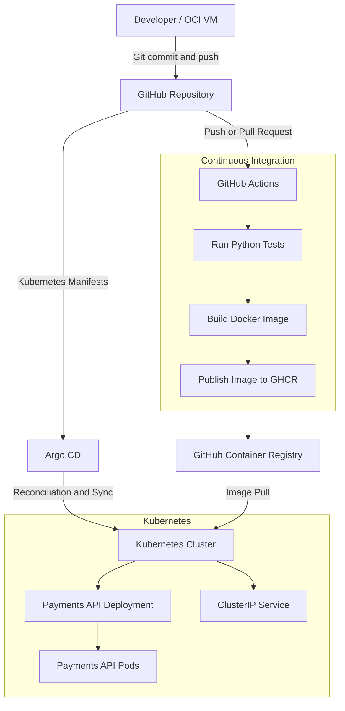

# Secure Payments GitOps Platform

An end-to-end DevOps project demonstrating containerization, CI automation, Kubernetes deployment, and GitOps-based continuous delivery for a simulated payments API.

## Overview

The Secure Payments GitOps Platform is a hands-on DevOps project built to demonstrate an automated application delivery workflow.

The application is a Python FastAPI service that exposes endpoints for health checks and simulated payment creation and retrieval.

The project implements:

- Automated application testing using GitHub Actions.
- Docker image creation and publishing to GitHub Container Registry (GHCR).
- Kubernetes cluster provisioning using kubeadm.
- Container networking using Calico.
- Kubernetes manifest management using Kustomize.
- GitOps-based deployment and reconciliation using Argo CD.
- Container and Kubernetes workload security configurations.

The payment application is intended for demonstration purposes only. It does not process real financial transactions or integrate with payment gateways.

## Architecture



## Technology Stack

| Category | Technologies |
|---|---|
| Application | Python, FastAPI, Uvicorn |
| Version Control | Git, GitHub |
| CI | GitHub Actions |
| Containerization | Docker |
| Container Registry | GitHub Container Registry (GHCR) |
| Orchestration | Kubernetes, kubeadm, kubectl |
| Container Runtime | containerd |
| CNI | Calico |
| Package Management | Helm |
| Kubernetes Configuration | Kustomize |
| Continuous Delivery | Argo CD |
| Infrastructure | Oracle Cloud Infrastructure (OCI) |

## Repository Structure

```text
secure-payments-gitops-platform/
│
├── .github/
│   └── workflows/
│       └── ci.yaml
│
├── app/
│   ├── src/
│   │   └── payment_api/
│   │       └── main.py
│   ├── tests/
│   │   └── test_api.py
│   ├── Dockerfile
│   ├── .dockerignore
│   └── requirements.txt
│
├── k8s/
│   ├── base/
│   │   ├── deployment.yaml
│   │   ├── service.yaml
│   │   └── kustomization.yaml
│   │
│   └── overlays/
│       └── lab/
│           └── kustomization.yaml
│
├── argocd/
│   └── payments-app.yaml
│
├── dashboards/
├── monitoring/
├── docs/
│   └── runbooks/
│
├── .gitignore
└── README.md
```

## Application

The Payments API is implemented using FastAPI.

### API Endpoints

| Method | Endpoint | Description |
|---|---|---|
| GET | `/health` | Application health endpoint |
| GET | `/ready` | Application readiness endpoint |
| POST | `/payments` | Creates a simulated payment |
| GET | `/payments/{payment_id}` | Retrieves a simulated payment |

The application validates payment request data using Pydantic and generates unique payment identifiers using UUIDs.

Payment records are stored in an in-memory Python dictionary.

### Running Locally

Create and activate a virtual environment:

```bash
cd app

python3 -m venv .venv
source .venv/bin/activate
```

Install dependencies:

```bash
pip install -r requirements.txt
```

Start the API:

```bash
PYTHONPATH=src uvicorn payment_api.main:app \
  --host 0.0.0.0 \
  --port 8080
```

Test the health endpoint:

```bash
curl http://localhost:8080/health
```

Interactive API documentation:

```text
http://localhost:8080/docs
```

### Running Automated Tests

```bash
cd app
PYTHONPATH=src pytest -v
```

The test suite validates application health, readiness, payment creation, invalid request handling, and payment retrieval errors.

## Containerization

The application is containerized using Docker and based on the `python:3.12-slim` image.

The Dockerfile:

- Installs application dependencies.
- Copies the application source code.
- Creates a dedicated non-root application user.
- Runs Uvicorn as the non-root user.
- Exposes application port 8080.

The `.dockerignore` file excludes unnecessary files such as Python caches, local virtual environments, tests, and environment files from the Docker build context.

Build the image:

```bash
docker build -t secure-payments-api:local ./app
```

Run the container:

```bash
docker run -d \
  --name payments-api \
  -p 8080:8080 \
  secure-payments-api:local
```

## Continuous Integration — GitHub Actions

The CI pipeline is defined in:

```text
.github/workflows/ci.yaml
```

It is triggered by:

- Pushes to the `main` branch.
- Pull requests targeting the `main` branch.

The workflow consists of three jobs.

### 1. Run API Tests

- Checks out the repository.
- Sets up Python 3.12.
- Installs application dependencies.
- Executes automated tests using pytest.

### 2. Build Docker Image

- Checks out the repository.
- Builds the Docker image using the application Dockerfile.
- Uses the Git commit SHA as the image tag.

### 3. Publish Image to GHCR

- Runs after successful testing and image building.
- Publishes only for pushes to `main`.
- Authenticates using GitHub's automatically provided `GITHUB_TOKEN`.
- Uses the minimum required package permissions.

The image is published using a commit-specific tag:

```text
ghcr.io/abdelrahmanwael97/secure-payments-api:<commit-sha>
```

Using the Git commit SHA provides traceability between the application source revision and the published container image.

## Kubernetes Platform

The lab environment was built using a single-node Kubernetes cluster on an OCI virtual machine.

### Cluster Components

| Component | Purpose |
|---|---|
| kubeadm | Kubernetes cluster initialization |
| kubelet | Kubernetes node agent |
| kubectl | Kubernetes administration |
| containerd | Container runtime |
| Calico | Pod networking and NetworkPolicy support |

The cluster was initialized using kubeadm, and Calico was installed through the Tigera Operator.

The single-node lab configuration allowed workloads to run on the control-plane node.

### Kubernetes Resources

The application is deployed through the following resources:

- **Deployment:** Maintains two Payments API replicas.
- **Service:** Exposes the application internally using ClusterIP.
- **Namespace:** Separates the application into the `payments` namespace.

The Service exposes port 80 and forwards traffic to the application container on port 8080.

### Workload Security

The Kubernetes Deployment includes several security controls:

- `runAsNonRoot: true` to prevent root execution.
- Explicit non-root UID and GID.
- `allowPrivilegeEscalation: false`.
- Dropping all unnecessary Linux capabilities.
- `readOnlyRootFilesystem: true`.
- Seccomp profile set to `RuntimeDefault`.
- A dedicated temporary `emptyDir` volume for `/tmp`.

### Resource Management and Health Checks

The Deployment defines CPU and memory requests and limits to control workload resource consumption.

It also includes:

- **Readiness probe:** Uses `/ready` to determine whether the Pod should receive traffic.
- **Liveness probe:** Uses `/health` to determine whether the container should be restarted.

## Kubernetes Configuration with Kustomize

Kustomize is used to organize the Kubernetes configuration into a reusable base and an environment-specific overlay.

The base contains:

- Deployment.
- Service.
- Kustomization definition.

The lab overlay:

- References the base configuration.
- Sets the `payments` namespace.
- Replaces the placeholder image with the GHCR repository and commit-specific image tag.

Render the final Kubernetes manifests:

```bash
kubectl kustomize k8s/overlays/lab
```

## GitOps Continuous Delivery — Argo CD

Argo CD was installed into the Kubernetes cluster using Helm.

The Argo CD Application resource is defined in:

```text
argocd/payments-app.yaml
```

It specifies:

| Configuration | Value |
|---|---|
| Repository | GitHub project repository |
| Target revision | `main` |
| Application path | `k8s/overlays/lab` |
| Destination | Local Kubernetes cluster |
| Namespace | `payments` |

The Application uses automated synchronization with:

- **Automated Sync:** Applies desired configuration from Git.
- **Prune:** Removes managed resources deleted from the desired configuration.
- **Self-Heal:** Reconciles supported manual changes that cause configuration drift.
- **CreateNamespace:** Automatically creates the application namespace.

The Application resource is initially registered with Kubernetes:

```bash
kubectl apply -f argocd/payments-app.yaml
```

Argo CD then monitors the configured Git repository and reconciles the Kubernetes cluster with the desired configuration.

The application was verified through the Argo CD dashboard with successful synchronization and healthy workload status.

## Deployment Verification

Check the Argo CD Application:

```bash
kubectl get applications -n argocd
```

Check the application Pods:

```bash
kubectl get pods -n payments -o wide
```

Check the Deployment and Service:

```bash
kubectl get deployments,services -n payments
```

Access the API through port forwarding:

```bash
kubectl port-forward -n payments \
  svc/payments-api 8081:80
```

Test the application:

```bash
curl http://localhost:8081/health
curl http://localhost:8081/ready
```

## Project Scope and Limitations

This project demonstrates a working CI and GitOps-based delivery workflow, but it is not a production payment-processing platform.

Current limitations include:

- Payment records are stored in application memory and are not persisted in a database.
- The application does not implement real payment gateway integration or authentication.
- The Kubernetes environment is a single-node lab cluster, not a highly available production cluster.
- The Kubernetes image tag is updated through Git rather than automatically by the CI pipeline.
- Prometheus and Grafana monitoring, Terraform provisioning, image vulnerability scanning, and image signing were not implemented in this version.

Because payment data is stored in memory, multiple application replicas do not share the same payment records. A production implementation would require persistent shared storage.

The OCI lab resources were terminated after the project was validated to avoid ongoing cloud costs. The GitHub repository and published container image remain available.

## Future Improvements

Potential next improvements include:

- Integrating Prometheus and Grafana for application and cluster monitoring.
- Adding automated container image vulnerability scanning.
- Introducing image signing and software supply-chain security.
- Automating GitOps manifest updates after successful image publication.
- Provisioning cloud infrastructure using Terraform.
- Introducing persistent application storage and authentication.
- Implementing multi-environment deployment and controlled promotion.
- Expanding to a highly available Kubernetes architecture.

---

**Disclaimer:** This is a learning and demonstration project. It is not intended for processing real payments or handling production financial data.
